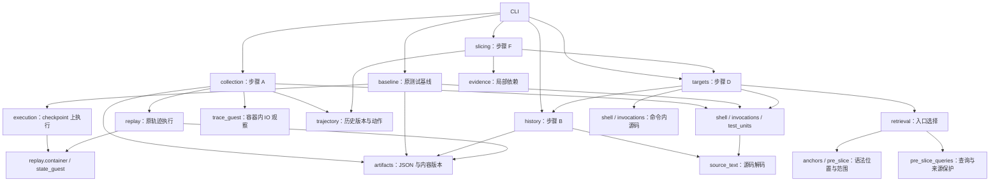

# EviWeave 原型架构

本方案对应[设计稿的步骤 A–L](../../research/eviweave_design_review_20261030/README.md)。当前 A/B/D/F 已连接：A 在 replay 中保存历史版本及实际输入输出，B 提供可回读材料，D 选择匹配点，F 在对应历史执行环境中恢复程序依赖与材料来源。完整 typed graph、组合规划和 oracle inference 尚待实现。

## 当前代码

```text
eviweave/
  __main__.py             collect / history / targets / slice / baseline 命令行
  artifacts.py            JSON 读写、内容标识
  replay/                 可独立运行的轨迹重放
    __main__.py           python -m eviweave.replay
    core.py               原始输入 → 按序执行 → checkpoint → 提交状态比较
    trajectory.py         ATIF 工具调用、观测与提交边界
    container.py          Docker 会话、命令执行、复制、checkpoint
    command_guest.py      容器内运行命令，记录输出、返回码、超时
    state.py              提交状态比较的宿主侧入口
    state_guest.py        独立构建 base + patch，比较 HEAD / index / 文件
  collection.py           步骤 A：版本、历史执行关联、当前测试清单
  blobs.py                内容寻址分块、版本回读与采集间共享
  trace_guest.py          容器内系统调用观察：实际文件版本、进程、管道、输入输出
  python_cache_guest.py   在原 Python 环境中比较保存的源码与普通/pytest 字节码
  trajectory.py           历史材料、执行动作、版本状态及输入输出依赖闭包
  history.py              A 材料读取、B 三字段记录及原文回读
  source_text.py          Python 声明编码与其他 UTF-8 源码的解码
  targets.py              步骤 D：A/B 适配、编写来源、入口输出和源码回读
  anchors.py              D 共用的语法解析、名称与位置匹配
  retrieval.py            D 选择：历史范围、来源过滤、helper 与同源码依赖连接
  pre_slice.py            D 共用语法支持：来源绑定、helper、案例范围与模板标识
  pre_slice_queries.py    D 共用查询：issue/Patch 角色、词频和编写来源保护
  evidence.py             F：单一源码版本的 CFG、定义/对象状态依赖和局部切片
  slice_frontier.py       F：调用/源码输入端口、依赖末端、验证测试分组及源码语法保留
  material_entries.py     F：独立的命令、输出、数据与 snapshot 入口
  slicing.py              F：历史版本绑定、跨文件/helper/hook 切片及 D→F 批量入口
  snapshot_runner.py      replay 过程中读取测试、fixture、配置
  shell.py                heredoc、写文件、内联脚本与 runner 的语法识别
  invocations.py          调用范围、具名结果与测试定义的对应
  test_units.py           各语言测试的名称、位置、版本与 runner 类型
  execution.py            从 checkpoint 运行构建与测试命令
  baseline.py             将执行结果归属到选定测试
  issue_filter.py         B/C 筛选 pilot：原始历史窗口、词法候选和语义排序提示
  llm.py                  单次 DeepSeek 请求，保留原始响应和实际用量
```

依赖方向如下。箭头表示调用；replay 只调用传入的采集回调，不导入 collection。



`replay` 仅依赖 Python 标准库、Docker、Git。直接复制整个 `eviweave/` 包后即可使用 `python -m eviweave.replay`，不会导入测试语法解析器、旧 Pilot 或模型 SDK。采集器使用 tree-sitter 等现有依赖。

## 接口与数据流

1. `load_case(id, input_directory, base_commit=None)` 从原始 `task.toml` 取得 image 和 base；短提交号在这里解析。
2. `replay_case(case, input_directory, out, observer_factory=None)` 接收已解析的 case，每条历史命令执行一次，产生最终 checkpoint 和提交状态比较结果。`case` 的字段是 `id / image / base_commit`。
3. `collect_tests(case, input_directory, out)` 为 replay 提供 `ReplayTrajectoryCollector`，同步产生 `tests/manifest.json` 和 `tests/trajectory.json`。回调依次为 `start / before_action / run_action / after_action / capture_submission / finish`。采集器通过 `run_action` 提供观察脚本；replay 自身不导入观察算法。
4. `read_source(manifest, path, sha256=None)` 取最终或指定历史版本的源码。内容摘要是版本标识；同一份字节只存一份。
5. `run_in_checkpoint(checkpoint, command, out, ...)` 从 `{image_id, head}` 创建执行副本，运行显式构建命令和测试命令，返回原始结果。
6. `run_selected_test(manifest, test_id, command, out, ...)` 从 manifest 取得 checkpoint，连接具名结果与测试定义，形成基线结果。
7. `history_records(manifest_path)` 读取 A 的文件版本和 replay 的已执行命令/输出，返回三字段材料列表；`read_context(source)` 按来源地址读取完整原文。B 默认只在内存中整理材料。
8. `targets_from_manifest(manifest_path)` 读取已验证提交状态的 A 产物，从 issue/Patch 和历史来源选择候选代码范围，返回查询名称、锚点、编写代码的局部查询位置、修改文件路径、语法模板组、完整 B 记录和解析／源码缺口；不选择单条测试。F 复用这些查询位置，不重新读取 Patch 源码来生成查询。
9. `read_target_source(unit)` 回读入口对应的完整文件、命令内脚本或字面写文件。入口的字节坐标均相对于此函数返回文本的 UTF-8 字节，不相对于检索窗口或带 shell 引号的命令。依赖 shell 展开的脚本保留原命令并标记为未解析。
10. `TrajectorySlicer(manifest).location(source, start, end, consumer=None)` 从匹配点回到实际读取该版本的执行，返回局部程序切片和外层轨迹闭包。指定 `consumer` 可限定一次读取；默认分别保留不同执行上下文。
11. `slice_targets(manifest, out)` 将 D 位置降低为调用或源码输入端口，同一验证测试的多个依赖末端共同切片，分别处理历史执行和静态版本上下文；保存原始端口、独立材料入口及完整 B。入口组保留 `program_entries`，相同程序视图共用一个文件，轨迹闭包按需展开。

命令、返回码、stdout、超时属于执行事实；具名结果归属、版本对应、目标是否到达属于分析结果。测试非零返回码不会被容器层自动解释为揭错成功。

主要产物及后续使用方式：

|产物|主要字段|后续消费者|
|---|---|---|
|`inputs/`|issue、task 配置、Patch、原 trajectory|B 的历史索引，C 的任务要求，D 的目标选择|
|`checkpoint.json`|最终 `image_id / head`|A 的基线，L 的候选执行|
|`tests/snapshots/`、`tests/blobs/`|位置、路径、内容版本、fixture / 配置|B 的版本索引，F 的局部证据恢复|
|`tests/executions/`|调用位置、输出引用、前后文件状态引用|B 的执行来源，F 的实际执行条件|
|`runtime/calls/<action>/trace/`|实际系统调用事件、原始字节、字节码源码对应结果|A 构建版本与 IO 关系|
|`tests/trajectory.json`|材料、动作、关系、初始/最终状态、逐次版本变化|F 恢复中间状态与材料来源|
|`tests/manifest.json`|单一 tests 清单、保留标记、源码版本与运行关联|D–E 的组合起点和检索输入|
|切片目录的 `graphs / slices / views / episodes`|共享源码图、匹配端口、程序视图、外层轨迹切片起点|G 的 typed graph 输入|
|`material_entries.json`|选中动作及原因、数据文件来源、引用完整 B 的记录 ID|输出/追加代码/snapshot 等材料的后续关联|
|基线或候选的 `result.json`|构建结果、执行结果、源码前后状态|L 的反馈分析，外部评估统计|

## 后续模块安排

|步骤|计划模块|输入 → 输出|实现边界|
|---|---|---|---|
|B 历史材料（已实现）|`history.py`|A 的实际材料 → `id / text / source` 候选列表|`text` 供检索，`source` 指向 A 的既有材料；原文按需从来源读取，不复制版本/运行字段，不另建词表与多套元数据索引；不索引 reasoning|
|C 检查事项|`requirements.py`|issue、当前测试/目标 → 少量相关条款和检索提示|可并入 D/E 的一次分析；LLM 给出原文引用；原始历史继续可查|
|D 切片入口（已实现）|`targets.py / retrieval.py`|A/B、Patch、issue → 查询、入口／范围、模板组和完整 B 材料|完整保留编写单元；对原有测试按角色、词频和历史范围匹配；查询与选择函数由正式入口和 Pilot 共用|
|E 检索顺序|`retrieval.py`|目标、检查事项、B 的全量记录 → 处理顺序|名称和来源只安排顺序；不按 Top-K、零词法分数或语法解析失败排除材料|
|F 证据恢复（已接入）|`evidence.py / trajectory.py / slicing.py`|版本、匹配点及实际 IO → 程序切片与轨迹闭包|局部数据/控制/状态依赖、静态调用与常见 setup、实际材料读写；未解析动态值显式保留|
|G typed graph（待实现）|待步骤 F 稳定后添加|切片及执行来源 → 可匹配的类型化证据图|区分具体对象、顺序、状态与观察；按原始入口保留匹配端口|
|G 结构排序|`fingerprints.py`|局部图 → 可比较的结构特征和分数|独立于证据恢复，方便关闭或替换后做消融|
|H–J 组合规划|`planning.py`|当前测试、证据图、检查事项 → 排序后的组合计划|先写对象绑定、顺序与状态条件；支持多个条件共同成立；预算在此统一分配|
|K 生成与 oracle|`composition.py`|组合计划及规则依据 → 测试代码、断言/MR 和适用解释|断言的依据必须明确；观察不到、规则未定时给出具体原因|
|L 反馈|`feedback.py`|计划、测试执行、目标探测 → 反馈或后续计划|分别记录条件是否建立、目标是否执行、观察是否有效、测试结果|
|全流程|`pipeline.py`|任务输入与预算 → 候选测试及执行记录|在 B–E 打通后添加；各步直接调用普通函数|

图结构首先服务于对象、顺序和状态检查，再加入结构指纹排序。全局预算由一个 run 配置和计数器管理；不在各模块内重复设置隐含上限。LLM 调用集中在实际需要模型的步骤；当前 `llm.py` 为筛选 pilot 提供单次请求入口，不自动重试或设置输出 token 上限。

外部 `scripts/` 负责样本选择、批量实验、Verifier/参考实现评估和统计。算法只读当前任务的公开材料。人工结论与 Verifier 答案通过评估入口加入，不进入上述生成过程。

## 本次精简的内容

- 去掉基线的完整 Pilot plan、qualification 与多轮收据核验；checkpoint 直接来自 manifest。
- 去掉观察器宽泛异常捕获、空文件列表回退、缺失字段回退和重复内容摘要校验。程序错误会在原位置抛出。
- 去掉 replay 的自动复用、损坏文件恢复分支和结束时逐文件签收。输出目录在入口创建一次；新检查使用新目录。
- 去掉逐文件竞争检测、重复读取和任意文件大小拦截；采集的内容摘要只用于源码版本与去重。
- 旧 `tramask_rerun` replay 路径仅保留薄转发。EviWeave 的基线已不再依赖旧实验 runtime。

保留的检查直接决定研究结果：原始调用与观测能否对应；未执行命令是否被排除；checkpoint 的 HEAD、index、字面文件是否等于 base + Patch；具名结果是否对应当时的测试版本；基线执行是否改动测试或 Patch 文件。源码语法错误、静默汇总、skip、缓存结果和同名歧义也保留为具体观测。

后续实现遵循仓库根目录 [AGENTS.md](../../AGENTS.md)。每个新检查都应能回答：如果删除它，会造成哪项研究结论出错？

## F 的轨迹切片与程序切片

`SourceGraph({id, path, raw})` 在一个源码版本上构建语句依赖；`criterion(start, end)` 将 D 的 UTF-8 字节位置归到语句。`ContextProgram` 在该次执行的版本环境中向前追踪使用该结果或对象状态的语句，向后补齐其数据、控制和状态依赖，并连接 helper 调用者、可解析的 import 和常见测试 setup。返回调用端口、参数对应、源码范围与未解关系。

`TrajectoryGraph` 在外层连接文件版本、执行和流数据。从程序切片涉及的材料和读取事件出发，向后找生产输入，向前找消费者和观察，再补齐这些观察的输入。时间顺序用于确定文件状态；不会仅因两个动作相邻就建立依赖。一次进程内已读输入到后续输出的关系标为 `process_may_depend`，保留其保守性。

实际文件/流读写、静态调用解析、框架 setup 规则分别标识。`state_at(event)` 表示观察到的物理文件状态；`context(event).source_versions` 表示分析使用的源码版本。Python 可能在磁盘源码已修改后仍加载旧缓存，因此缓存须通过保存源码的编译结果验证；pytest 缓存使用原环境的断言改写器比较。此验证不执行目标源码。

初始及提交快照连接最终仓库；每次实际读写保存不可变材料版本，同一命令内创建、执行后删除的文件仍可恢复。实际 argv/stdin 的 Python/Node 程序成为代码材料；已知字面量 eval/exec 可进一步解析。输出、snapshot、无法解析的语言或动态生成值保留原始材料与来源，未取得内部值时明确标记。

文件和流使用 `BlobStore` 保存为完整内容摘要与 64 KiB 数据块清单；读取时按清单恢复原始字节。单轮采集共享数据块，多个轮次可显式指定同一数据块目录。每条命令采集后将其轨迹字节连接至采集库，并清除容器内观察临时目录；checkpoint 不包含这些临时文件。算法内部只处理当前格式。

同一语句的多个表达式共享一次切片，完全相同的节点和调用绑定共享一个结果，原始位置与入口均保留。严格包含关系仅统计，不据此删除小切片。每个来源的依赖图只存一次，切片用节点 ID 引用。

[入口、匹配与切片的联合 Pilot](../../research/entry_matching_slicing_20261103/README.md)在全部 88 条的归档源码上比较了依赖末端和验证测试分组。[正式接入与独立审查](../../research/joint_pipeline_alignment_20261103/README.md)将该策略接入 `slice_targets`：调用/源码输入位置归到语句，同一测试的依赖末端通过 `ContextProgram.grouped_slices` 共用遍历，保留注释、源码结构和内嵌程序分析。`slice_many` 执行多端口依赖遍历；`slice` 是其单端口入口。

`ContextProgram` 接收材料目录、版本上下文、共享源码图缓存和源码读取函数。`TrajectorySlicer` 按内容版本缓存规范化源码，原始编码只在读取边界处理一次；测试边界发现复用源码图中的缓存。D/F 共用已加载的轨迹与查询位置。调用者和全局效果先完成发现，再遍历依赖，函数自由读写集合不随查询修改。

实际未执行的源码使用其创建时或所属快照的静态上下文，解析该状态下的 helper、setup 和调用者；快照不被标为已执行输入。运行上下文中，同一路径若有多个内容版本，相关调用和 fixture 保留为 `version_alternatives`，不会同时确认为 `direct` 或 `framework_setup` 关系。候选源码版本及未解原因继续保留，不枚举版本组合。

`material_entries` 独立保留验证/执行/编写动作、源码来源与路径关联、呈 JSON/XML 形式的读取、明确提及的数据文件和相关 snapshot。`material_entries.json` 仅存来源和 B 记录 ID，不复制原文；程序视图覆盖与材料内容覆盖分别由评估脚本计分。

[88 条轨迹的旧静态 Pilot](../../research/slicing_pilot_20261103/README.md)保留原统计口径。[轨迹切片实现检查](../../research/trajectory_slicing_20261103/README.md)验证当前 A→B/D→F 连接，包括真实 Docker、历史删除文件及 S030 两条验证命令。当前局部依赖仍是静态切片，不是语句级动态执行路径。

[步骤 A 字段与采集审查](../../research/step_a_simplification_20261101/README.md)移除了测试目录副本、每测试的配置/实现状态副本、固定目标及基线占位值、fixture 依赖推断和自动构建命令分类。相关配置仅在基线选中测试后读取；原命令和运行事实引用 replay。观察器仍读取命令前后文件状态，相邻相同清单共用存储，不再重复查询 Git 的 HEAD/diff/status。提交一致性继续由独立 replay 验证。

## B/C 的筛选位置

[Issue 与历史筛选 pilot](../../research/issue_history_filter_20261031/README.md)将资料组织、issue 检索提示与后续语义排序分别比较。B 将候选文本连接到 A 的既有材料，位置、版本和调用关联继续由 A 持有；原设计中的准备条件、同一对象、观察时点和适用范围交给命中后的语义分析。

C 围绕当前目标提供少量相关要求，可与 D/E 合并。E 对 B 的全量候选安排处理顺序，分批执行不截断后续候选资格；H/I 取得具体组合计划后，再根据对象绑定、状态和执行顺序排除冲突。旧 Pilot 的 Top-K 仍作为已冻结的对照实验；新方法不以其输出作为完整证据集合。

[Reasoning 来源核对](../../research/reasoning_provenance_20261101/README.md)没有发现现有人工引用中必须从 reasoning 获取的片段。第一版 B 不处理全量 reasoning；后续目标分析存在具体未解问题时，可按步骤或标识符读取局部原文，作为待验证线索。历史执行事实由代码与运行记录支持，oracle 由 issue 或契约支持。

[阶段 B 字段审查](../../research/stage_b_field_audit_20261101/README.md)替代前一版记录设计。当前约定只保留 `id / text / source`，形成内存中的候选列表；E 直接复用词法排序。来源类别及标签从 `source` 读取，版本与运行记录不在 B 复制，完整上下文也按同一引用读取。没有当前消费者的派生字段与独立索引不预建。本轮精简能逐字恢复已有 64 份排序模型输入，不调用新 LLM。

[步骤 B 实现与检查](../../research/eviweave_step_b_20261101/README.md)使用 A 的现有文件版本、命令内源码和原始/replay 输出构造候选。来源地址为文件路径或已有 JSON 条目的引用，回读直接访问 A 的原文。旧 pilot 复用同一分块函数；材料列表可直接交给现有词法排序。

[D/E 历史选择特征分析](../../research/history_selection_features_20261101/README.md)建议以目标关联、条件/观察互补与具体连接线索指导检索和候选排序，并局部回查相关测试修订。这些是当前测试与候选之间的判断，不增加 B 字段或全局证据图。已有 pilot 验证了 issue/Patch 定向选择；各语义特征的独立增益留待同输入、同预算消融。

[切片入口分析](../../research/slicing_anchor_20261102/README.md)进一步收敛 D：优先定位任务相关程序元素的具体使用点，由 F 从 receiver、实参、结果和对象状态恢复局部依赖，互补性与组合判断主要放在切片之后。独立历史测试各有入口；S085 的 JSON 数据需来源连接，S088 历史缺少的 Info 调用需后续生成，不由切片自动恢复。

[全部 88 条的确定性入口实验](../../research/deterministic_anchor_20261102/README.md)取消任务类型预分类。该轮读取选定测试的调用和字段，再定位其他使用点；当前默认 D 已改为 issue/Patch 查询，不选择单条测试。同名只作为检索候选，对象、别名及相关接口的连接由局部分析确认。

实验按原始 donor 来源核对 128 段引用：调用规则命中 72 段，扩展规则命中 98 段，其中 14 段是字符串材料。扩展规则的前 80 个候选保留 52 段；仅搜索历史写入/内联代码时为 76 段，但会丢失其他源码中的 10 段可定位引用。D/E 当前提供候选入口；来源可用于预算分配，更强的对象/调用关联排序应在局部依赖恢复后验证。外部评估脚本为 `evaluate_deterministic_anchors.py` 和 `audit_deterministic_anchor_donors.py`；完整单元定位不等于依赖切片成功。

## 召回优先的当前约定

[召回约束与保留检查](../../research/high_recall_history_20261102/README.md)替代前述按固定候选预算淘汰材料的建议。后续阶段的候选集合是 B 的全量记录；`rank_units` 仅提供优先切片的位置，不能代替完整材料集合。未命中名称、低排名、解析失败、输出数据及契约材料继续传递，不能只留在归档中而失去后续处理资格。

相同文本在不同来源中分别保留 `id / text / source`，避免丢失导入、文件版本或执行背景。同一函数中匹配同一名称的所有表达式位置都保留。相同字节可复用语法解析，但类型和执行关联仍按实际来源恢复。B 不增加字段；实际 IO 的来源关系由 A 的轨迹图持有。

本阶段先减少重复解析和重复建图工作；局部切片限制需要深入处理的代码范围，typed graph 匹配再限制可组合的节点和边，最后进行 Oracle Inference。效率比较以已标注证据不丢失为前提，同时报告未恢复来源和未处理材料；不能把未处理解释为无相关证据。

[步骤 D 的实际接入与验证](../../research/eviweave_step_d_20261102/README.md)将上述约定接到 `targets_from_manifest` 和 `python -m eviweave targets`。A 材料只加载一次，同时供 B 分块和 D 解析使用。文件位置引用 A 原始版本；内联脚本用原命令地址及解码片段序号读取，不复制源码。历史源码匹配阶段按字节和语法种类复用解析结果，来源分别保留。issue 代码名称不使用跨语言关键词黑名单，以免误删 Python 的 type/range 或其他语言中的合法名称。

[检索收窄与 LLM 位置实验](../../research/step_d_selectivity_20261102/README.md)进一步核对全部 88 条：125 是语义条件数，135 是引用条目数，去重后有 128 段引用；旧评估的 98 是其中能够对齐为完整语法单元的子集。128 段原文均存在，旧排除项包括追加写入、跨单元片段和输出数据，不应解释为历史缺失。

`retrieval.py` 的收窄实验使用最内层修改声明、语法角色、工具历史中的文件/测试及 runner 可能覆盖的范围，以及同版本导入/setup/helper 连接；另为非 AST 材料保留事件与数据入口。语法候选由 404,283 降到 78,487，匹配位置由 5,373,763 降到 698,977；加上依赖后保留原来的 98/98 段代码引用，完整来源检查为 128/128。仅按显式名字限制文件范围的消融不能覆盖未打印名字的套件测试，不作为推荐规则。代码单元保留和来源可达分别计量，尚未实现程序切片。该轮当时的 `targets` 仍提供宽检索基线，收窄方案由外部实验入口调用；当前入口已按下述新实验更新。

本轮的 LLM issue 查询与有限词表选择均有漏报；固定 12 任务的匹配组筛选只减少 1.4% 候选。因此收窄实验不把 LLM 选择作为默认硬筛选，后续仍优先实现局部依赖恢复，再验证更细的匹配或组合筛选。

2026-11-03 按用户决定停止“仓库自身 API 作为排他入口”的优化。新增[五项切片前优化 Pilot](../../research/pre_slice_five_pilot_20261103/README.md)分别检验查询词控制、来源匹配、helper 桥接、实际案例范围和严格版本去重。该轮实验由脚本调用；组合保留 98/98 可定位引用，但候选代码量只减少 4.70%，尚未证明解决切片规模问题。

[切片前查询与来源保护探索](../../research/pre_slice_query_exploration_20261103/README.md)在全部 88 条上继续比较两轮各 8 条件。推荐完整保留任务中编写的语法单元，对仓库原有测试按查询角色和词频筛选；保留代码引用 98/98，候选源码由 47.06 MB 降至 29.99 MB。`pre_slice_queries.py` 与既有 `pre_slice.py` 为共用算法；正式 `targets` 已接入推荐配置，同时保留完整 B 材料。词频阈值直接应用于全部来源会漏报，不能省略编写来源的保护。


## D 当前默认实现

`targets_from_manifest` 一次读取 A/B 的文本和来源；提交快照解释 Patch。新采集的轨迹按实际写入判断编写来源，避免把首次读到的依赖库视为 Agent 编写。旧快照产物继续按初始版本区分。字面写文件和内联脚本直接连接到原命令。

`retrieval.retrieve_entries` 固定使用角色查询、32 单元弱词频阈值及编写来源保护；`select_entries` 是正式选择与 Pilot 消融共用的一份实现。D 返回具体锚点、候选范围及编写代码的局部查询位置。`slicing.slice_targets` 将它们降低为调用或源码输入端口，观察语句由依赖切片补齐；未降低出端口的材料继续保留在完整 B 中，并记入 `pending_roots`。

`units` 的非空 `anchors` 标识入口；空锚点单元提供词法支持。`ranges` 供后续限制分析区域，完整源码由原始引用回读；`syntax_templates` 保存单元索引组，供语法准备复用。完整 B `records` 继续传给后续分析。

当前接入与全部 88 条逐来源复核见[优化后的 D 实现记录](../../research/eviweave_d_optimized_20261103/README.md)。
